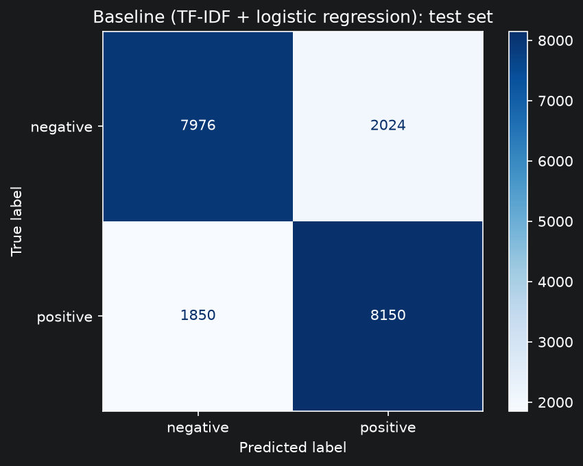
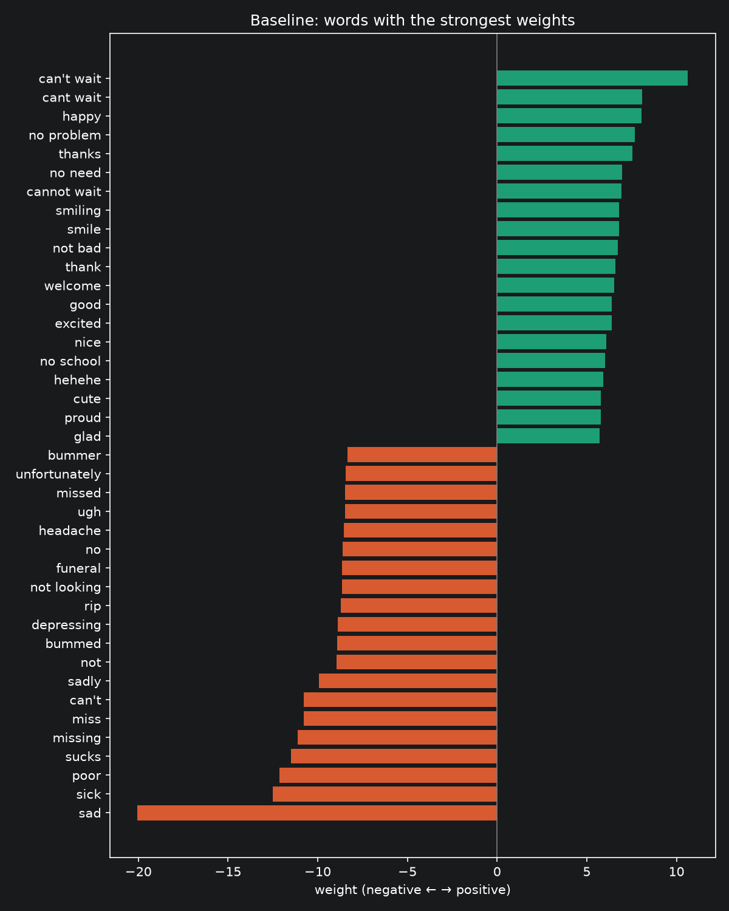

# Tweet Sentiment, Revisited

In a class project I classified tweet sentiment and reached about 60% accuracy.
This project revisits the problem with a TF-IDF + logistic regression baseline
and a fine-tuned transformer, compares them on the same test set, and analyzes
where each one fails.

## Status
- ✅ Data exploration, cleaning and fixed splits
- ✅ Baseline: TF-IDF + logistic regression (80.6% test accuracy)
- 🚧 Transformer (DistilBERT): in progress

## Data
[Sentiment140](https://www.kaggle.com/datasets/kazanova/sentiment140): 1.6 million tweets from 2009, labeled positive or negative.
The labels come from emoticons (":)" = positive, ":(" = negative) that were then removed from the text, so they are noisy.
In a hand-checked sample of 50 tweets, about 10% of labels were wrong and 12% of tweets had no real sentiment.

Download the data from Kaggle and place
`training.1600000.processed.noemoticon.csv` in `data/`.

## Method
**Cleaning and splits** ([02_make_splits](notebooks/02_make_splits.ipynb)):
removed 2,378 tweet texts that appeared with both labels and 17,003 duplicates, then took a balanced sample of 240,000 tweets,
split into 200,000 training, 20,000 validation and 20,000 test tweets (stratified, `random_state=42`).

**Preprocessing** ([src/preprocess.py](src/preprocess.py)): HTML leftovers converted, lowercased,
URLs and @mentions replaced with placeholders, `#` removed from hashtags.

**Baseline** ([03_baseline](notebooks/03_baseline.ipynb)): TF-IDF (words and word pairs, contractions and `!`/`?` kept as tokens)
with logistic regression. Settings were tuned on the validation set; the test set was used once.

## Results

| Model | Test accuracy | Macro F1 | Training time | Hardware |
|---|---|---|---|---|
| TF-IDF + logistic regression | 0.8063 | 0.8063 | 0.6 s | MacBook CPU |
| DistilBERT (fine-tuned) | coming soon | | | |

### Key findings (baseline)
- **Word pairs matter:** using single words lowered validation accuracy by 1.3 points, because pairs capture words such as "can't wait", which is one of the top positive words.
- **Small preprocessing details matter more than vocabulary size:** keeping contractions ("can't") and `!`/`?` as tokens gave the a clear gain (+0.55 points), while three-word phrases or keeping every rare word added nothing.
- **The strongest words make sense:** "can't wait", "love" (positive), "sad", "sucks" (negative).

### Limitations
[fill in later]

## Project structure
data/ dataset and splits (not in the repo)
notebooks/ 01 exploration · 02 splits · 03 baseline
src/ shared preprocessing code
results/ tuning tables, test predictions, figures

## How to reproduce
1. Create a virtual environment and run `pip install -r requirements.txt`.
2. Download the dataset into `data/` (see Data above).
3. Run the notebooks in order: 01, 02, 03.