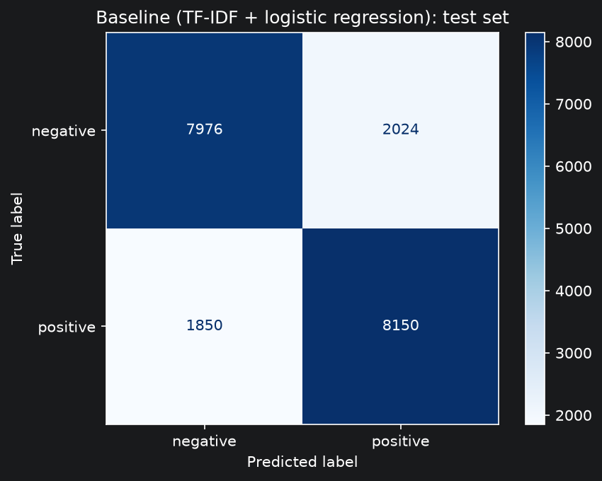
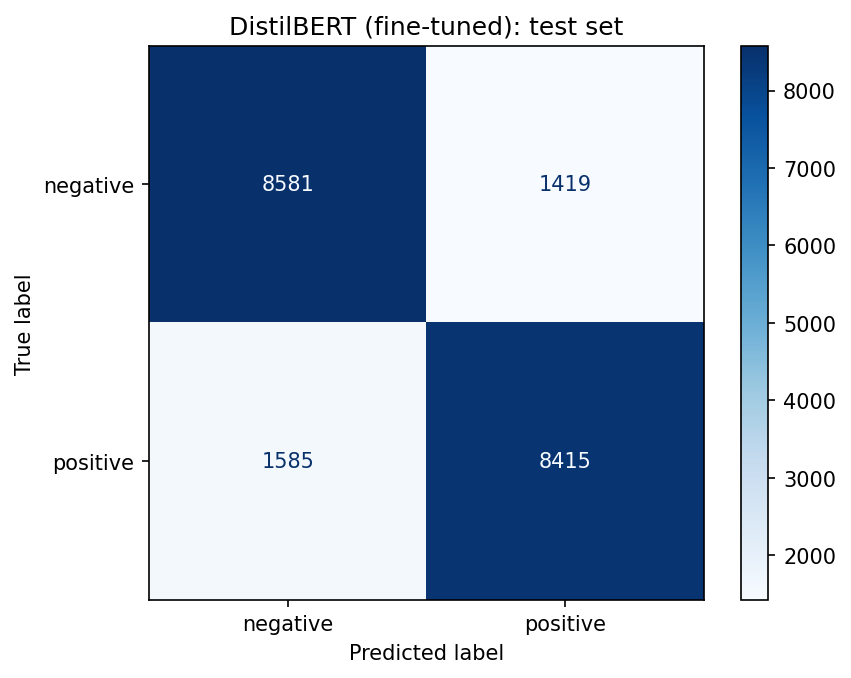
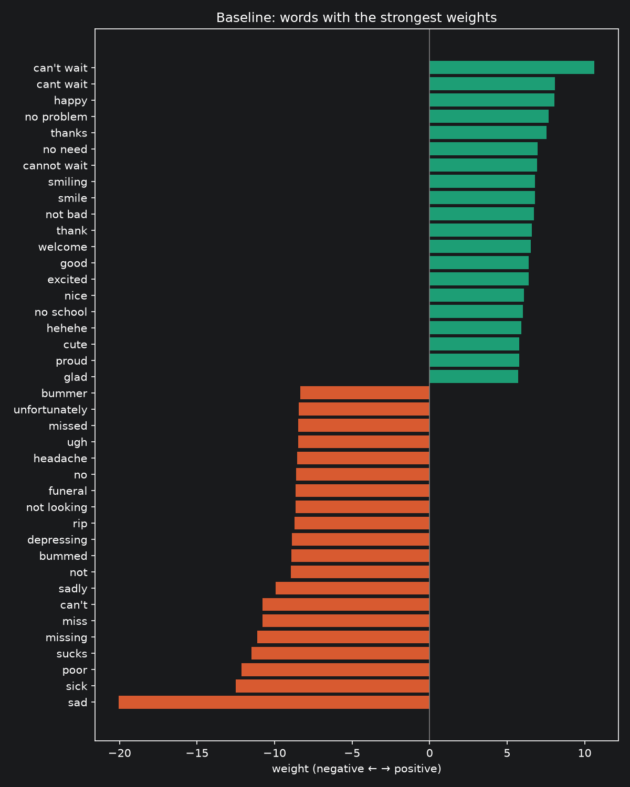

# Tweet Sentiment, Revisited

In a class project I classified tweet sentiment using word lists and reached about 60% accuracy.
In this project I tried the same problem again with machine learning. I built a TF-IDF + logistic regression baseline,
fine-tuned a DistilBERT transformer, compared them on the same test set, and looked at where each one fails.

## Status
- ✅ Data exploration, cleaning and fixed splits
- ✅ Baseline: TF-IDF + logistic regression (80.6% test accuracy)
- ✅ Transformer: fine-tuned DistilBERT (85.0% test accuracy)
- 🚧 Error analysis: in progress

## Data
I used [Sentiment140](https://www.kaggle.com/datasets/kazanova/sentiment140), which has 1.6 million tweets from 2009 labeled positive or negative.
The labels were made from emoticons (":)" = positive, ":(" = negative), and the emoticons were then removed from the text, so some labels are wrong.

The data is not in this repository. To run the project, download it from Kaggle and put
`training.1600000.processed.noemoticon.csv` in `data/`.

## Method
**Cleaning and splits** ([02_make_splits](notebooks/02_make_splits.ipynb)):
I removed 2,378 tweet texts that had both labels (8,675 rows) and 17,003 duplicates.
Then I took a balanced sample of 240,000 tweets and split it into 200,000 for training, 20,000 for validation and 20,000 for testing (stratified, `random_state=42`).

**Preprocessing** ([src/preprocess.py](src/preprocess.py)): both models use the same cleaning. I fixed HTML leftovers, lowercased the text,
replaced URLs and @mentions with placeholders, and removed `#` from hashtags.

**Baseline** ([03_baseline](notebooks/03_baseline.ipynb)): TF-IDF with single words and word pairs, keeping contractions and `!`/`?` as tokens,
then logistic regression. I tuned the settings on the validation set.

**Transformer** ([04](notebooks/04_transformer_prep.ipynb), [05](notebooks/05_transformer_training.ipynb), [06](notebooks/06_transformer_evaluation.ipynb)):
I fine-tuned `distilbert-base-uncased` on Kaggle GPUs for 2 epochs, with a learning rate of 2e-5 and a maximum length of 64 tokens.
The best epoch was picked using the validation set.

I tested each model only once, on the test set it had never seen.

## Results

| Model | Test accuracy | Macro F1 | Training time | Prediction time (20K tweets) | Parameters | Size |
|---|---|---|---|---|---|---|
| TF-IDF + logistic regression | 0.8063 | 0.8063 | 0.6 s | 0.36 s | 128,537 | 4 MB |
| DistilBERT (fine-tuned) | **0.8498** | **0.8498** | 16.5 min | 18.1 s | 66,955,010 | ~268 MB |

The baseline ran on a MacBook Pro (Apple M2 Pro, 32 GB RAM). DistilBERT ran on 2 Tesla T4 GPUs on Kaggle, and predicted with a batch size of 128 and fp16.

| Baseline | DistilBERT |
|---|---|
|  |  |

## Key findings

### Baseline (TF-IDF + logistic regression)
- **Word pairs matter.** Using single words only lowered validation accuracy by 1.3 points. Pairs keep meaning that single words lose: "can't wait" is one of the strongest positive features, even though "can't" on its own sounds negative.
- **Small preprocessing choices mattered more than vocabulary size.** Keeping contractions like "can't" and `!`/`?` as tokens gave the only clear gain (+0.55 points). Three-word phrases and keeping every rare word did not help.
- **The strongest words make sense.** "can't wait" and "love" are the most positive, and "sad" and "sucks" are the most negative.



### DistilBERT vs. the baseline
- **DistilBERT makes 22% fewer mistakes** (3,004 vs. 3,874 out of 20,000 test tweets). Most of the improvement is on negative tweets that the baseline called positive (2,024 → 1,419). This fits with DistilBERT reading the whole sentence, for example "great idea, unfortunately…".
- **More data and a second epoch helped DistilBERT.** Validation accuracy was 82.5% with 50K tweets and 1 epoch, 84.1% with 200K tweets, and 85.1% after the second epoch.
- **The baseline is much cheaper.** It trains about 1,650× faster, predicts about 50× faster (on a laptop vs. two GPUs), and is about 67× smaller.

### Both models
- **Wrong labels limit accuracy.** When I checked 50 random tweets by hand ([01_explore_data](notebooks/01_explore_data.ipynb)), about 10% had the wrong label and 12% had no real sentiment. So no model can get close to 100% on this data.

## Limitations
- Some labels are wrong, so part of the remaining error comes from the labels, not the models.
- Every tweet has to be positive or negative, even tweets with no sentiment.
- The data is from 2009, and some non-English tweets are garbled because of an encoding error in the original file.
- The baseline only understands word order through word pairs. DistilBERT is harder to explain and needs a GPU to train.

## Project structure
```
data/          dataset and splits (not in the repo)
notebooks/     01 exploration · 02 splits · 03 baseline · 04–06 transformer
src/           shared preprocessing code
results/       tuning tables, test predictions, figures, training logs
```

## How to reproduce
1. Create a virtual environment and run `pip install -r requirements.txt`.
2. Download the dataset into `data/` (see Data above).
3. Run notebooks 01, 02 and 03 on your computer.
4. Upload `data/splits/` and `src/preprocess.py` as a Kaggle dataset, then run notebooks 05 and 06 on a Kaggle GPU.
   The fine-tuned model (~268 MB) is not in the repository.